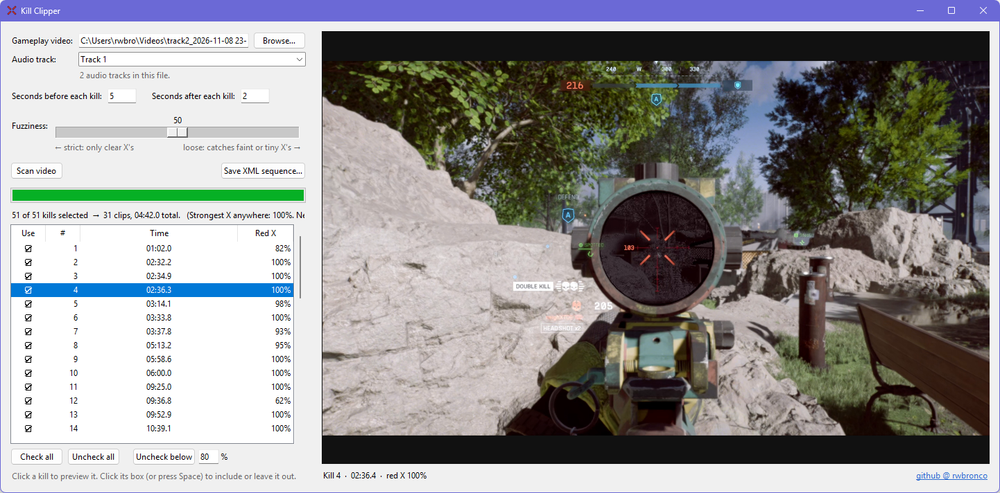

# Kill Clipper

Kill Clipper is a small Windows app that cuts long Battlefield 6 gameplay recordings down to just the kills. Give it an .mp4 or .mkv, and it uses NumPy and FFmpeg to detect kill shots in your video. Save the result as a Final Cut Pro 7 XML file and Adobe Premiere Pro or DaVinci Resolve opens it as a ready-cut sequence linked to your original video. You can adjust the detection fuzziness, preview and exclude individual detections, change the clip duration before-and-after each kill, and it even handles multi-track audio! Kill Clipper runs on Python 3 using Tkinter (included with Python) for the window, plus two add-ons installed by the setup file: numpy for the image analysis, and imageio-ffmpeg, which supplies FFmpeg for reading video. It writes no temporary files; everything happens in memory.

============

FIRST-TIME SETUP
----------------
1. Make sure Python is installed (https://www.python.org/downloads/).
   When installing, tick "Add python.exe to PATH".
2. Double-click  "1 - Setup (run once).bat"  and wait for "All done!".

USING IT
--------
1. Double-click  "2 - Run Kill Clipper.bat".
2. Choose your gameplay video (the file your video editor will use):
   drag it onto the Kill Clipper window, or click Browse...
3. Pick the Audio track you want in the Premiere sequence (Track 1,
   Track 2, ... - the same numbering VLC uses).
4. Type how many seconds to keep before and after each kill.
5. Click "Scan video". Expect a few minutes per hour of footage.
6. Check the list of kills. If needed, adjust the Fuzziness slider:
     - move RIGHT if kills are being missed,
     - move LEFT if it's finding things that aren't kills.
   The list updates instantly - no need to scan again.
7. Review the kills in the preview on the right:
     - Click a kill (or use the up/down arrow keys) to see that moment.
     - Click its box, or press Space, to leave it out (☐) or put it back (☑).
       You can select several rows and press Space to toggle them together.
     - "Check all", "Uncheck all" and "Uncheck below __%" do it in bulk.
   Only ticked kills go into the Premiere sequence. Unticked kills stay
   unticked when you move the slider.
8. Click "Save XML sequence..." and save the .xml file.
9. In Premiere: File > Import, choose the .xml. A new sequence appears,
   already cut down to just the kills, using your original footage.

The preview window can be resized, and you can drag the divider between the
options and the preview. The picture scales to fit.

Kills close together are merged into one clip, so a double or triple kill
becomes one continuous clip instead of overlapping copies.

OTHER EDITORS
-------------
The .xml is in the Final Cut Pro 7 XML format, which DaVinci Resolve can
also import (File > Import > Timeline). Set the Resolve project's frame
rate to match your recording before importing.

TIPS
----
- You can also drag a video onto "2 - Run Kill Clipper.bat" (or onto
  your shortcut) to open Kill Clipper with that video already loaded.
- The detector expects the crosshair at the centre of the screen and the X
  to be red. If a colour-blind or HUD colour setting changes its colour,
  it won't be found.
- Advanced: it also runs from the command line:
    python kill_clipper.py VIDEO BEFORE AFTER FUZZINESS OUTPUT.xml [AUDIO_TRACK]
