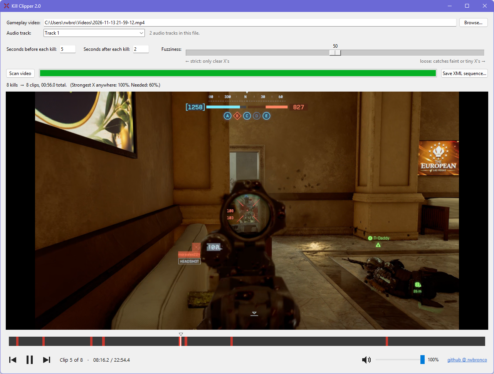

# Kill Clipper

Kill Clipper is a small Windows app that cuts long Battlefield 6 gameplay recordings down to just the kills.

Give it an .mp4 or .mkv, and it uses NumPy and FFmpeg to find every kill shot. A built-in player then plays your original video showing only the kills. Nothing is cut or re-saved.

Features

Kills-only playback: plays your original video and jumps over everything between kills.
Kill timeline: every kill shows in red. Click one to jump to it.
Previous / next buttons: skip from kill to kill, whether the video is playing or paused.
Adjustable detection: change the fuzziness and how much of each clip plays before and after the kill. Playback updates instantly.
Multi-track audio: pick the track you want to hear, set the volume or mute it.
Export for editing: save the kills as a Final Cut Pro 7 XML file. Adobe Premiere Pro or DaVinci Resolve opens it as a ready-cut sequence linked to your original video.

Requirements

Python 3, with Tkinter (included with Python) for the window
Installed by the setup file:
numpy: image analysis
imageio-ffmpeg: supplies FFmpeg for reading video
py7zr: unpacks the video player download
mpv video player (libmpv-2.dll)

Scanning and playback write no temporary files; everything happens in memory.

==============

## FIRST TIME
1. Install Python from https://www.python.org/downloads/ (64-bit) and tick
   "Add python.exe to PATH" on the first installer screen.
2. Double-click "1 - Setup (run once).bat". It installs three add-ons
   (numpy, imageio-ffmpeg, py7zr) and downloads the video player
   (libmpv-2.dll, about 30 MB) into this folder.

## USING IT
1. Double-click "2 - Run Kill Clipper.bat" (or drag a video onto it).
2. Drag your recording onto the window, or click Browse.
   It opens in the player right away and plays normally until you scan.
3. Pick the audio track you want to hear. This is also the track that goes
   into the XML sequence.
4. Set "Seconds before / after each kill", then click "Scan video".
5. The timeline under the video now shows each kill clip in red.
   Press Play and you'll see only the kills, back to back.

## PLAYER CONTROLS
Play / Pause
- button, or the Space bar.

Previous / Next kil
- buttons, or the Left / Right arrow keys. They jump to the start of the previous / next kill clip and don't change playing or paused.
                           
Timeline
- click a red kill section to jump to it. The grey parts between kills can't be clicked.

Volume
- speaker button mutes (or press M); the slider sets the volume.

Changing the before/after seconds or the Fuzziness slider updates the clips instantly. No need to scan again.

Kills close together are merged into one clip, so "Clip 3 of 10" can contain more than one kill.

## FUZZINESS
   Move RIGHT if kills are being missed, LEFT if it finds things that
   aren't kills.

## SAVING FOR PREMIERE / RESOLVE
1. Click "Save XML sequence...".
2. Premiere: File > Import, pick the .xml.
3. Resolve:  File > Import > Timeline, pick the .xml.

## IF THE VIDEO AREA SAYS THE PLAYER ISN'T INSTALLED
   Click "Install video player" in the video area, or run the setup file
   again. If the download can't be unpacked automatically, the downloaded
   .7z file is saved in this folder: open it (Windows 11 opens .7z files;
   on Windows 10 use 7-Zip) and copy libmpv-2.dll into this folder.
   Manual download: https://github.com/shinchiro/mpv-winbuild-cmake/releases
   (the file named mpv-dev-x86_64-DATE.7z, not the "v3" one).
   To update the player later, delete libmpv-2.dll and run setup again.
